<div align="center">

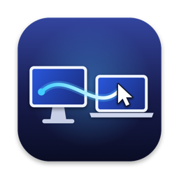

# Seamline

**One keyboard and mouse for every Mac on your desk.**

A native macOS app that sends your pointer, keystrokes and clipboard to the next Mac
when you push past the edge of the screen. No server, no account, no telemetry.

[](https://github.com/mralifakbar/seamline/actions/workflows/ci.yml)
[](https://github.com/mralifakbar/seamline/releases/latest)


[](LICENSE)

<picture>
  <source media="(prefers-color-scheme: dark)" srcset="docs/images/5-pointer-away-dark.png">
  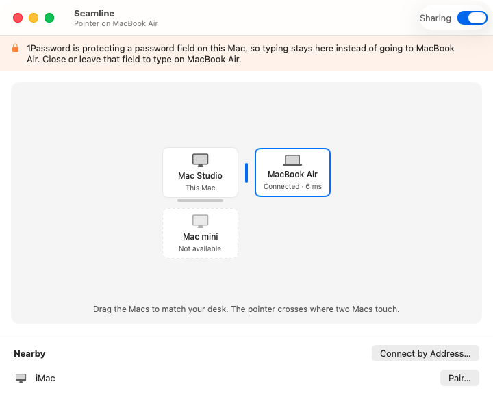
</picture>

</div>

## Features

- **Native.** Swift and SwiftUI, one universal app for Apple silicon and Intel, macOS
  13 Ventura or later.
- **No setup server, no IP addresses.** Macs find each other over Bonjour. Tailscale
  and other VPNs work too.
- **Encrypted and paired.** Two Macs are linked only after you compare a 6-digit code
  on both screens.
- **Fast.** About 6 ms round trip over Wi-Fi between a Mac mini and a MacBook Pro
  (see [Measured](#measured)).
- **Clipboard follows the pointer.** Text, rich text, images, PDFs and links.

## Install

### Download

1. Grab `Seamline-x.y.z.zip` from the [latest release](https://github.com/mralifakbar/seamline/releases/latest).
2. Unzip it, move **Seamline.app** to `/Applications` and open it. Do this on every
   Mac you want to use.
3. Continue with [Set up](#set-up).

Releases are signed with a Developer ID and notarized by Apple, so macOS opens them
without a warning. macOS ties the Accessibility and Input Monitoring permissions to
that signature, so updates keep them. Coming from 0.1.0, which was signed ad-hoc,
switch Seamline off and on again in both lists once.

### Build from source

Requires macOS 13 or later and Xcode 16 or later (Swift 6). The Command Line Tools
are enough.

```sh
git clone https://github.com/mralifakbar/seamline.git
cd seamline
./scripts/build-app.sh && cp -R build/Seamline.app /Applications/
```

`./scripts/build-app.sh --zip` builds what releases ship: an arm64 + x86_64 app and a
zip. Local builds use the first `Apple Development` or `Developer ID Application`
certificate in your keychain, or ad-hoc if there is none. Set
`SEAMLINE_SIGN_IDENTITY="Apple Development: …"` to choose one. Sign with a real
certificate if you can: an ad-hoc build loses its permissions on every rebuild. With
a `Developer ID Application` certificate, `scripts/notarize.sh build/Seamline.app`
notarizes the result the way releases are.

To get a build onto another Mac, copy `build/Seamline.app` over (AirDrop, a shared
folder or `scp`) and put it in `/Applications` there.

## Set up

Use one Mac as the **host**: the one with the keyboard and mouse you want to share.
Every other Mac is a **guest**. Setup takes about a minute.

### 1. Choose a role on each Mac

Open Seamline. On the Mac with the keyboard and mouse, choose **This Mac**. On every
other Mac, choose **Another Mac**.

<picture>
  <source media="(prefers-color-scheme: dark)" srcset="docs/images/1-choose-role-dark.png">
  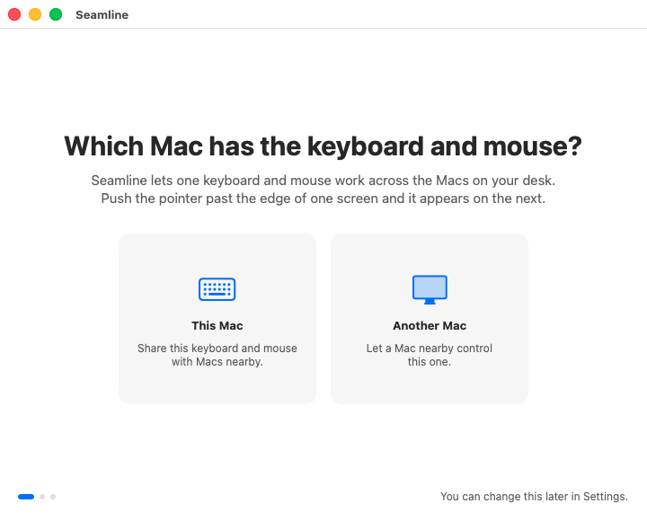
</picture>

### 2. Allow the permissions

macOS asks before any app can read input or control the pointer. Select **Allow…**
next to each permission, switch Seamline on in System Settings, then come back. The
page updates by itself.

| Permission | Host | Guest | Why |
| --- | :---: | :---: | --- |
| Accessibility | ✓ | ✓ | Holds the pointer at the edge on the host, and clicks and types on the guest. |
| Input Monitoring | ✓ | | Reads the keyboard so keystrokes can go to the Mac the pointer is on. |
| Local Network | ✓ | ✓ | Lets the Macs find each other. macOS asks the first time Seamline searches. Select **Allow**. |

<picture>
  <source media="(prefers-color-scheme: dark)" srcset="docs/images/2-permissions-dark.png">
  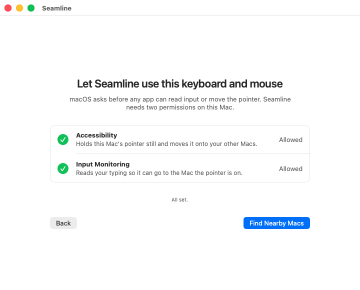
</picture>

Then select **Find Nearby Macs** on the host, or **Make This Mac Visible** on a guest.

### 3. Pair

On the host, the guest appears under **Nearby**. Select **Pair…** next to it. Both
Macs then show the same 6-digit code. If the codes match, select **Pair** on the host
and **Allow** on the guest.

<p>
<picture>
  <source media="(prefers-color-scheme: dark)" srcset="docs/images/3-pair-host-dark.png">
  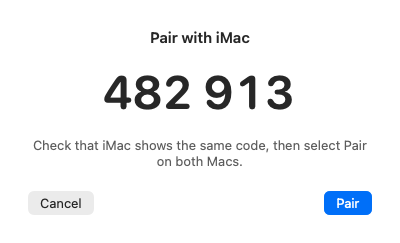
</picture>
<picture>
  <source media="(prefers-color-scheme: dark)" srcset="docs/images/3-pair-guest-dark.png">
  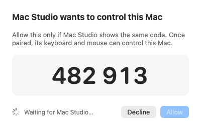
</picture>
</p>

You pair only once. After that, the two Macs reconnect by themselves whenever both
are running Seamline, including after sleep.

### 4. Arrange the Macs to match your desk

The guest appears next to the host in the arrangement. Drag each Mac to the side
where it sits on your desk, or select it and use the arrow keys. The blue bar marks
the edge the pointer crosses.

<picture>
  <source media="(prefers-color-scheme: dark)" srcset="docs/images/4-arrangement-dark.png">
  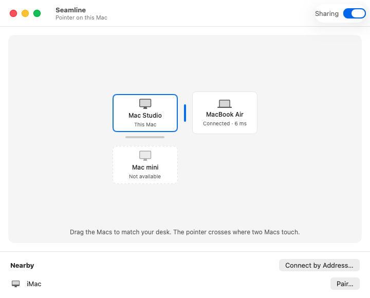
</picture>

That's it. Push the pointer past that edge and it moves to the other Mac.

## Usage

- **Move between Macs.** Push the pointer past the shared edge. A little resistance
  stops accidental switches; change it under **Settings › Edge resistance**. Screen
  corners never switch, so Hot Corners keep working.
- **Come back from anywhere.** Press <kbd>⌃</kbd> <kbd>⌥</kbd> <kbd>⌘</kbd> <kbd>Esc</kbd>.
- **Copy and paste across Macs.** Copy on one Mac, move the pointer over, and paste.
  The clipboard travels when the pointer crosses, and only if it changed.
- **Pause sharing.** Use the **Sharing** switch in the window or the menu bar.
- **See the connection.** The menu bar shows each Mac with its measured round trip,
  for example `6 ms, Wi-Fi`.

<p>
<picture>
  <source media="(prefers-color-scheme: dark)" srcset="docs/images/menu-bar-dark.png">
  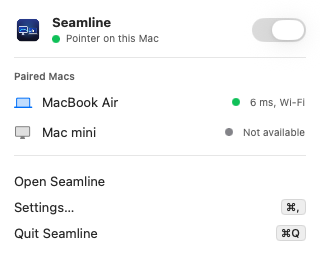
</picture>
</p>

On a guest, the window shows whether it is free or in use:

<p>
<picture>
  <source media="(prefers-color-scheme: dark)" srcset="docs/images/guest-ready-dark.png">
  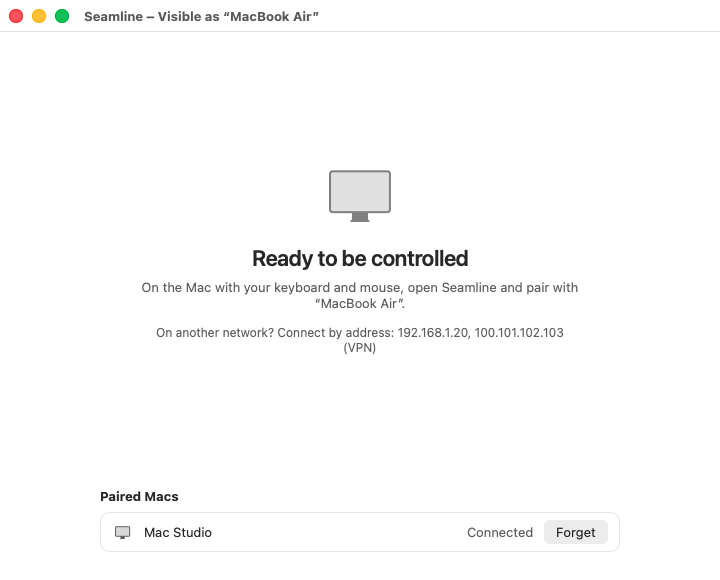
</picture>
<picture>
  <source media="(prefers-color-scheme: dark)" srcset="docs/images/guest-controlled-dark.png">
  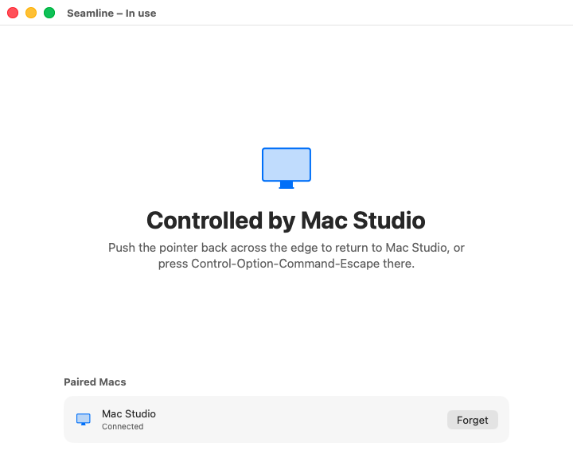
</picture>
</p>

### Macs on different networks

If the guest is on another network, for example reachable only over Tailscale,
Bonjour can't see it. On the host, select **Connect by Address…** and enter the
address shown in the guest's window, such as `100.101.102.103` or
`macbook.tailnet.ts.net`. Seamline remembers the address and reconnects by itself.

## Troubleshooting

| Problem | Fix |
| --- | --- |
| Seamline isn't in the **Input Monitoring** or **Accessibility** list | Select **Allow…** in Seamline's window, which adds it to the list. Or select **+** under the list in System Settings and choose Seamline from Applications. |
| The host keeps saying "Looking for Macs" | Check **System Settings › Privacy & Security › Local Network** on both Macs and switch Seamline on. Make sure the guest chose **Another Mac** and finished its setup. Both Macs must be on the same network, otherwise use **Connect by Address…**. |
| Permissions stopped working after an update or rebuild | The app's signature changed, so macOS treats it as a new app. Switch Seamline off and on again in both lists. Releases from 0.1.1 on, and builds signed with a certificate, keep them. |
| Typing stays on the host while the pointer is on a guest | A password field or a secure terminal has turned on Secure Input, which hides keystrokes from every app. Seamline shows a banner naming the app. Leave that field and typing goes across again. |
| The pointer feels slow | The menu bar shows the measured round trip. Over Wi-Fi expect 5 to 10 ms. Wired Ethernet on one Mac removes one wireless hop. |

## Measured

Mac mini to MacBook Pro, both on 5 GHz Wi-Fi through one access point. 20 s at
125 Hz motion plus 20 events per second:

| Path | Round trip p50 | p90 | p99 | Motion packets lost |
| --- | --- | --- | --- | --- |
| Same network | 6.4 to 6.6 ms | 8.8 to 11.6 ms | 19.8 to 34.7 ms | 0 of 1,780 |
| Tailscale | 7.6 ms | 10.0 ms | 23.3 ms | 0 of 1,820 |

Plain `ping` on the same link averaged 7.8 ms, so Seamline adds no measurable
overhead. The floor is the two Wi-Fi hops. Wired Ethernet on one side removes one of
them.

### Tested on real hardware

Last end-to-end run: 2 November 2026, a Mac mini (M4, macOS 26.6) as host with two
displays, and a MacBook Pro (2018, Intel, macOS 15.8) as guest, on the same Wi-Fi.

| Check | Result |
| --- | --- |
| Setup, permissions, Bonjour discovery and pairing with the 6-digit code | ✓ |
| Pointer crosses at the right edge of the host's second display and moves on the guest | ✓ |
| Typing on the host lands in TextEdit on the guest, including Shift and ⌘S | ✓ |
| ⌘⇧3 pressed on the host takes a screenshot on the guest | ✓ |
| Clipboard copied on the host is ready to paste on the guest, sent by Seamline rather than Universal Clipboard | ✓ |
| ⌃⌥⌘ Esc brings the pointer home | ✓ |
| Both Macs reconnect by themselves after Seamline restarts, without pairing again | ✓ |
| Round trip shown in the app | 7 to 25 ms over Wi-Fi |

## How it works

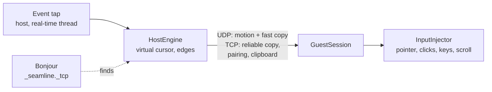

- **Discovery** (`SeamlineCore/PeerConnection.swift`). Bonjour (`_seamline._tcp`)
  over Wi-Fi, Ethernet and peer-to-peer Wi-Fi, so there are no IP addresses to type.
  Macs on another network, such as over Tailscale, connect by address, which is
  remembered. Peer-to-peer Wi-Fi is the last resort, because it time-shares the radio.
- **Transport** (`PeerConnection.swift`, `Reliability.swift`). Two encrypted paths on
  one port, both in the Wi-Fi voice service class. UDP carries pointer motion (newest
  position wins) and a fast copy of every key, click and scroll. TCP carries a
  reliable copy of the same events, plus pairing and the clipboard. The receiver takes
  whichever copy lands first, exactly once and in order, so a lost Wi-Fi frame never
  stalls typing behind a TCP retransmit. Every datagram also repeats the last 150 ms
  of events, so the next packet repairs a lost one. While the pointer is on another
  Mac, or heading toward one, a small probe every 20 ms keeps both radios out of power
  save and measures the round trip.
- **Pairing and encryption** (`SeamlineCore/Handshake.swift`). A Curve25519
  commit-then-reveal handshake. Both Macs derive the 6-digit code from the session
  transcript, so a man in the middle gets one guess in a million per attempt. Every
  frame is sealed with ChaCha20-Poly1305 and counter nonces per direction. Paired keys
  are pinned, so later sessions need no prompt.
- **Pointer** (`Platform/EventTap.swift`, `Engine/HostEngine.swift`). The host taps
  input on a dedicated real-time thread, freezes its own cursor, and keeps a virtual
  cursor in the other Mac's display space with sub-pixel deltas. Edges are detected
  per display, so L-shaped multi-monitor setups have no dead zones. Motion leaves at
  most every 4 ms (250 Hz), the first movement immediately, and falls back to TCP if
  UDP is blocked. Clicks carry their own position.
- **Keyboard and scrolling** (`Platform/InputInjector.swift`). Key codes are the same
  on every Mac, so keys travel as raw virtual key codes with modifier flags,
  autorepeat and keyboard type, media and brightness keys included. Pixel deltas and
  scroll and momentum phases are forwarded, so trackpad scrolling feels native.
- **Clipboard** (`SeamlineCore/Clipboard.swift`). Read only when the pointer crosses,
  and only if it changed. Compressed with LZFSE when that helps, and sent in 60 KB
  slices on a bulk lane that never delays keystrokes.

## Privacy

No account and no analytics. Seamline only talks to the Macs you pair, and every
frame between them is encrypted. The clipboard is read only when the pointer crosses
to another Mac. This Mac's identity and the Macs it has paired with stay in
`~/Library/Application Support/Seamline`, readable only by you.

## Development

```sh
swift build                # debug build
swift test                 # unit tests
./scripts/build-app.sh && open build/Seamline.app
```

[CONTRIBUTING.md](CONTRIBUTING.md) lists the development switches, including the
snapshot mode that renders the README screenshots and the two-Mac pairing and
benchmark modes.

## Known limits

- Mac to Mac only. Windows and Linux are not supported.
- Files are not transferred. Copy and paste covers text, rich text, HTML, images,
  PDFs and URLs.
- The interface is in English only.

## Contributing

Bug reports from real multi-Mac setups, fixes and pull requests are welcome. Start
with [CONTRIBUTING.md](CONTRIBUTING.md). To report a security issue, follow
[SECURITY.md](SECURITY.md) instead of opening an issue.

## License

[MIT](LICENSE) © Alif Akbar Kartadinata
